  <a href="https://abdulhabeeb.com"><strong>abdulhabeeb.com</strong></a> ·
  <a href="https://www.linkedin.com/in/abdulhabeeb9731/">LinkedIn</a> ·
  <a href="mailto:abdulhabeeb9731@gmail.com">Email</a> ·
  <a href="https://abdulhabeeb.com/public/resources/Abdul_Habeeb_Resume.pdf">Resume</a>

I turn complex systems and datasets into products people can understand and use with confidence — from data analysis and visualization to full-stack web apps.

- 🔬 Research Assistant at the [FGVT Research Group](https://fgvt.htwsaar.de/site), htw saar — transportation data, visualizations, and analytical reports
- 🎓 Master's in Data Science &amp; AI at Saarland University
- 🏆 1st place, Lithuania (2026) and Estonia Hackathon (2025) · 2nd place, Germany Hackathon (2025)

### Featured projects

More work, client sites, and testimonials at **[abdulhabeeb.com](https://abdulhabeeb.com)**.

### Tools I use

&nbsp;&nbsp;&nbsp;&nbsp;&nbsp;&nbsp;&nbsp;&nbsp;&nbsp;&nbsp;&nbsp;&nbsp;&nbsp;&nbsp;&nbsp;

Cards regenerate daily via GitHub Actions — see <code>SETUP.md</code>.
